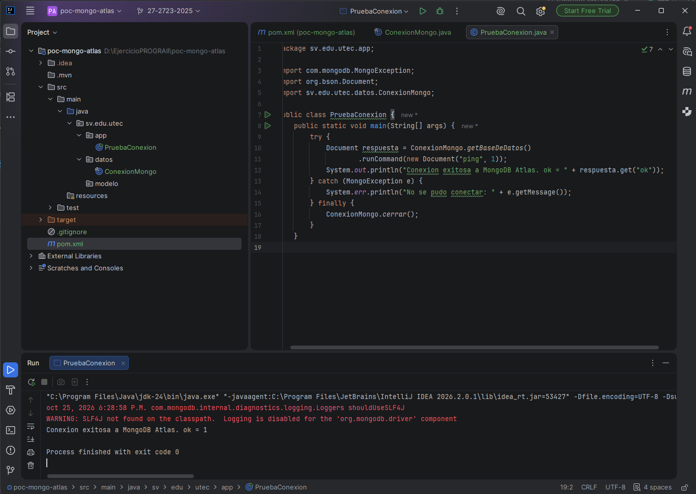

# Guía de Laboratorio N.º 3 - MongoDB Atlas con Java

**Asignatura:** Programación III (PROG3-I)  
**Ciclo:** 02-2026  
**Estudiante:** Angel Miguel Olmedo Cruz  
**Carnet:** 27-2723-2025

---

## 1. Descripción del Proyecto
Prueba de concepto (PoC) para conectar una aplicación Java con MongoDB Atlas utilizando el driver síncrono oficial versión 5.13.0 y gestión de dependencias con Maven. La cadena de conexión y credenciales de acceso se administran de forma segura mediante la variable de entorno `MONGODB_URI`.

---

## 2. Evidencias de la Práctica

### Evidencia 1: Conexión y Ping a MongoDB Atlas
Verificación exitosa del comando `ping` contra el clúster en la nube recibiendo respuesta del servidor con `ok = 1`.

